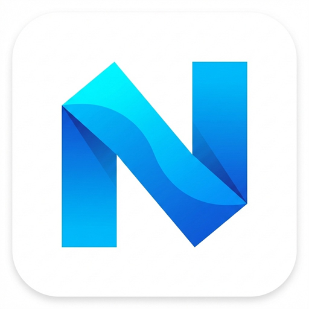

<p align="center"></p>

# nemix（ネミックス）

中央サーバーを一切持たない、100% P2P・サーバーレスの E2EE 暗号化メッセンジャー & SNS です。

- **オフライン通信** — Bluetooth LE / Wi-Fi Aware メッシュで、災害時や機内でも近くの端末と直接つながります
- **プラットフォーム非依存** — 中央サーバーがないため、特定企業の規約変更や障害に左右されません
- **トラフィック分散** — 端末間の直接通信で帯域を節約。画像は高圧縮し、EXIF を完全に除去します

## リポジトリ構成

| ディレクトリ | 内容 | 状態 |
|---|---|---|
| [`bitchat-android/`](bitchat-android/) | Android アプリ（メイン実装） | 開発中・最優先 |
| [`nemix-ios/`](nemix-ios/) | iOS アプリ（SwiftUI） | 開発中・CI でビルド検証 |
| [`website/`](website/) | 公式サイト（https://nemi-x.com 、Cloudflare Workers） | 公開 |
| [`TERMS_OF_SERVICE.md`](TERMS_OF_SERVICE.md) | 利用規約 | |
| [`PRIVACY_POLICY.md`](PRIVACY_POLICY.md) | プライバシーポリシー | |

## ダウンロード

Android の APK は [Releases](https://github.com/ShotaXiangtai/nemix/releases) から入手できます。
公式以外から入手した APK は使わないでください。

## ビルド

**Android**

```sh
cd bitchat-android
./gradlew :app:assembleDebug
```

**iOS**（Mac 不要。GitHub Actions の macOS ランナーでビルドします）

- `nemix-ios/` に変更を push すると [iOS ワークフロー](.github/workflows/ios.yml) がシミュレーター向けビルドと未署名 IPA を作成します
- Mac がある場合: `cd nemix-ios && brew install xcodegen && xcodegen generate` で `Nemix.xcodeproj` を生成して Xcode で開きます

## リリース

- [docs/RELEASING.md](docs/RELEASING.md) — 署名鍵、GitHub Releases、Mac なしの iOS ビルド
- [docs/STORE_RELEASE.md](docs/STORE_RELEASE.md) — Google Play（ベータ→正式）と TestFlight→App Store の公開手順

## ライセンス

nemix は **GNU General Public License v3.0** で公開しています（[LICENSE](LICENSE)）。

Android 版は permissionlesstech による [bitchat-android](https://github.com/permissionlesstech/bitchat-android)（GPL-3.0）の派生物です。
帰属表示と改変内容は [NOTICE.md](NOTICE.md) と [bitchat-android/NEMIX_CHANGES.md](bitchat-android/NEMIX_CHANGES.md) にあります。
nemix は bitchat プロジェクトとは無関係の独立したプロジェクトです。
